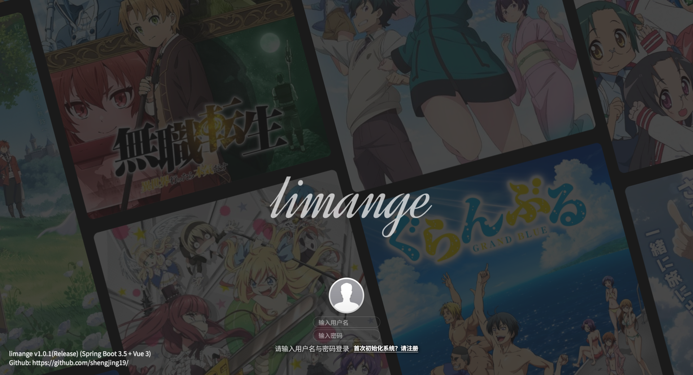
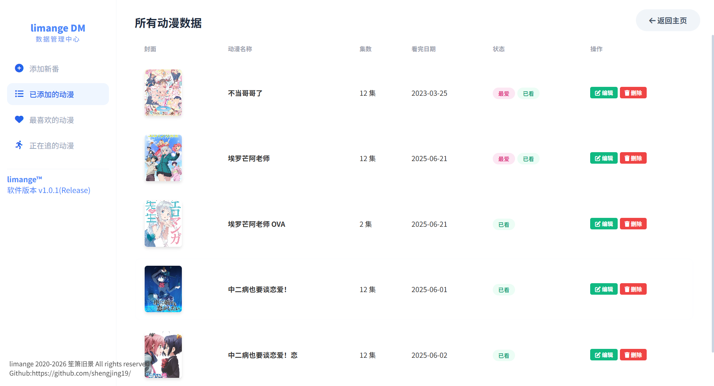

<p align="center">
  
</p>

## 桌面工作台 v1.1.1

新增漫画风格工作区、顶部标签、右侧内嵌数据管理、双登录样式和独立 EXE。v1.1.1 增加后台封面缩图、跨行更新和可导出的性能诊断，详见 [滚动优化与诊断说明](docs/scroll-performance.md) 和 [桌面使用、构建与性能报告](docs/desktop-workspace.md)。

- 便携版：`release/limange-1.1.1-portable.exe`，双击即可打开。
- 安装版：`release/limange-1.1.1-setup.exe`。
- 构建：`npm run desktop:build`。程序包含前端运行时，仍需连接已有 Newlimange 后端。

## 项目概览

`limange_Vue` 是 limange 动漫记录程序的桌面端前端项目，采用 Vue 单页应用与侧边栏导航。移动端已剥离为 [limange-mobile](limange-mobile/README.md) 独立项目，可单独复制、安装依赖、构建和部署。
<br>Tips:后端项目详见主页Newlimange

## 界面预览(PC端)

<table>
  <tr>
    <td align="center" width="50%">
      
      <br />
      <sub>登录页</sub>
    </td>
    <td align="center" width="50%">
      
      <br />
      <sub>主页列表</sub>
    </td>
  </tr>
  <tr>
    <td align="center" width="50%">
      
      <br />
      <sub>动漫详情</sub>
    </td>
    <td align="center" width="50%">
      
      <br />
      <sub>数据管理列表</sub>
    </td>
  </tr>
  <tr>
    <td align="center" colspan="2">
      
      <br />
      <sub>动漫添加中心</sub>
    </td>
  </tr>
</table>

## 技术栈

| 类型        | 技术                                     |
| ----------- | ---------------------------------------- |
| 核心框架    | Vue 3                                    |
| 构建工具    | Vite 5                                   |
| 路由        | Vue Router 4                             |
| 状态管理    | Pinia                                    |
| HTTP 客户端 | Axios                                    |
| 图表        | ECharts                                  |
| 动画        | animejs                                  |
| 样式单位    | postcss-pxtorem，桌面端根字号固定为 16px |
| 图标        | Font Awesome 6.4.0                       |

## 项目结构

```text
limange_Vue/
├── logo.png                         # 项目 Logo
├── index.html                       # Vite 入口 HTML
├── package.json                     # 项目依赖与脚本
├── vite.config.js                   # 桌面端 Vite 与 PostCSS 配置
├── limange-mobile/                  # 独立移动端工程（见该目录的 README）
├── public/
│   ├── img/                         # 静态图片与动漫背景图
│   └── fontawesome6.4.0/            # 本地图标资源
└── src/                            # 桌面端源码
    ├── api/                         # Axios 实例与业务 API 封装
    ├── assets/styles/               # 全局样式与变量
    ├── components/                  # 通用组件、布局组件、管理组件
    ├── composables/                 # 通知与确认框组合式能力
    ├── router/                      # 路由与登录守卫
    ├── stores/                      # Pinia 状态
    ├── utils/                       # 桌面端常量与工具函数
    └── views/                       # 登录、主页、数据管理页面
```

## 后端接口配置

在登录页的「服务器设置」或应用「设置」中填写后端地址，无需修改源码或重新打包。浏览器与桌面的出厂默认值统一位于 `shared/defaults.json`。

```json
{ "serverUrl": "http://192.168.30.12:8231" }
```

填写服务根地址，不需要追加 `/api`。桌面版通过主进程同源代理访问 API 和服务器图片；Web 部署仍需后端正确配置 CORS。

## 主要接口能力

### 认证接口

- `POST /auth/login`：登录并返回 JWT、用户名、演示账户标识。
- `POST /auth/register`：系统初始化注册首个用户。

### 动漫数据接口

- `GET /anime/main`：主页分类列表与统计总览。
- `GET /anime/{id}`：获取动漫详情。
- `GET /anime/list`：管理页分页列表。
- `GET /anime/tmdb/search`：TMDB 动漫检索。
- `POST /anime/add`：新增动漫。
- `POST /anime/update`：更新动漫。
- `DELETE /anime/{id}`：删除动漫。

### 统计接口

- `GET /anime/stats/weekly`：近七天统计。
- `GET /anime/stats/annual`：年度统计。

### 演示账户接口

- `GET /demo-user`：获取演示账户。
- `POST /demo-user`：创建演示账户。
- `PUT /demo-user/password`：修改演示账户密码。
- `DELETE /demo-user`：删除演示账户。

## 本地运行

### 1. 安装依赖

```bash
npm install
```

### 2. 启动开发服务

```bash
npm run dev
```

默认开发服务端口：

```text
http://localhost:3000
```

### 3. 构建生产包

```bash
npm run build
```

### 4. 本地预览构建产物

```bash
npm run preview
```

## 账户与权限说明

### 标准账户/管理员

标准账户可访问全部前端功能：

- 浏览动漫记录。
- 查看统计数据。
- 新增、编辑、删除动漫记录。
- 管理演示账户。
- 修改应用外观设置。

### 演示账户

演示账户用于给访客体验系统，只读访问数据：

- 可登录系统。
- 可查看动漫列表、详情和统计。
- 不可新增、编辑、删除动漫。
- 不可管理演示账户。

前端会隐藏演示账户的写操作入口，并在函数层进行二次拦截。真正的权限边界仍以后端鉴权和 403 响应为准。

## 开发规范说明

- 业务 API 统一封装在 `src/api/anime.js`。
- 鉴权状态统一由 `src/stores/auth.js` 管理。
- 通知与确认框统一由 `src/composables/useNotify.js` 管理。
- 不建议在组件中直接拼接后端完整 URL，应优先通过 API 封装调用。

## 许可证

[GPL-3.0 License](https://github.com/shengjing19/AnimeRecord-limange_Vue/blob/master/LICENSE)
