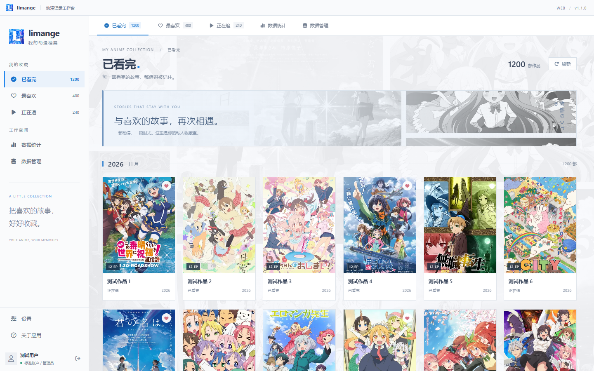
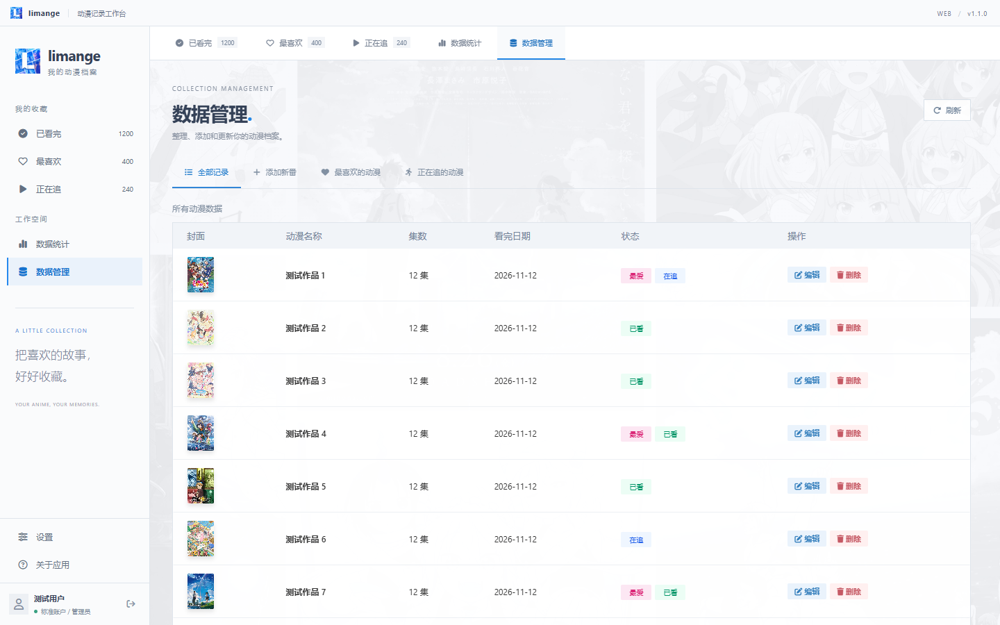
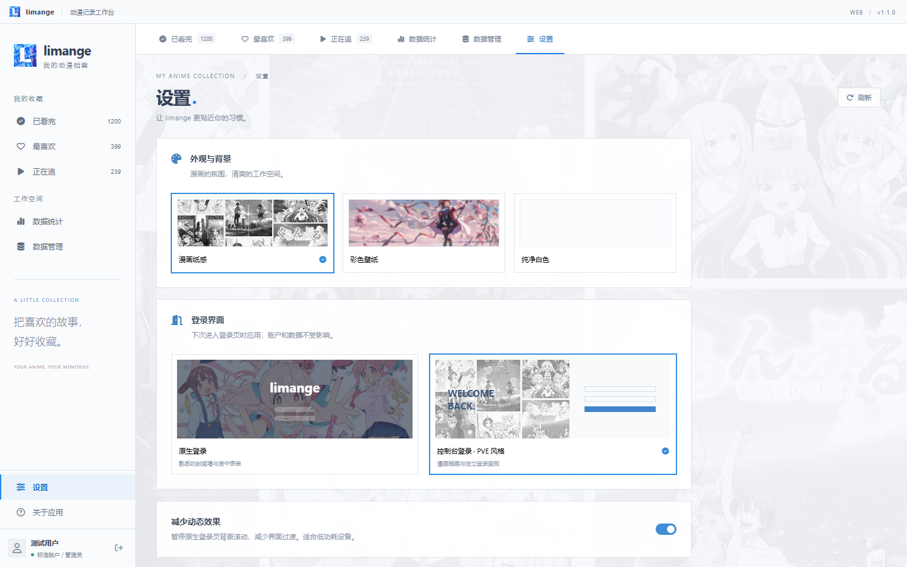

# limange 1.1 桌面工作台

2026-11-12。界面结构参考 [PVE-VDI](https://github.com/HtmACG/PVE-VDI)，使用 Vue 重新实现，保留 limange 的动漫记录、统计、初始化注册和演示账户功能。

## 直接运行

- `release/limange-1.1.1-portable.exe`：单文件便携版，双击运行，无需安装 Node、启动 Vite 或执行 BAT。
- `release/limange-1.1.1-setup.exe`：安装版，可选择安装目录，并创建桌面和开始菜单快捷方式。
- `release/win-unpacked/limange.exe`：已展开的程序，必须与该目录中的资源一起保留。

程序内置前端和 Electron 运行时。Newlimange 后端仍需运行在配置的服务器上；本项目不包含 Spring Boot 服务和数据库。登录页右上角「服务器设置」和应用「设置」均可修改后端地址。更换服务会退出当前账户。Web 版与桌面版各自保存登录状态。

桌面配置在 `%APPDATA%/limange/settings.json`，浏览器状态由 Electron 用户目录保存。关闭窗口会退出程序；再次双击运行中的程序会唤回已有窗口。

## 参考项目的实现方式与移植范围

| PVE-VDI 的设计                           | limange 的实现                                                  |
| ---------------------------------------- | --------------------------------------------------------------- |
| Electron 主进程 + 渲染进程               | `desktop/main.cjs` 创建独立窗口，Vite 构建的 Vue 界面作为渲染层 |
| 狭窄侧栏、细边框、蓝色选中线             | 固定侧栏、顶部标签、统一右侧工作区                              |
| 左插画、右登录面板                       | 控制台登录样式，与原生封面墙登录共用认证逻辑                    |
| 自定义标题栏                             | 拖动、最小化、最大化/还原和关闭按钮                             |
| electron-builder 的 portable / NSIS 输出 | 单文件 EXE、安装程序及 Logo 多尺寸图标                          |

数据管理不再跳往另一套全屏页面。顶部标签切换已看完、最喜欢、正在追、统计和管理；管理内部再切换全部记录、添加、最喜欢和正在追。旧 `/admin` 链接会进入统一工作区。管理表单和分页在标签切换时保留，写入成功后片库与统计缓存自动失效。

漫画壁纸用现有插画合成分镜、单色与网点，并离线压缩成 WebP。设置支持漫画纸感、彩色壁纸和纯色背景；原生登录与控制台登录均可选择并持久保存。减少动态效果默认开启，影响登录背景、详情转场和时间线。

## 桌面结构

```text
desktop/             Electron 窗口、受限 preload 桥、同源协议和后端代理
shared/defaults.json 浏览器与桌面共同的默认后端地址
src/components/layout/       标题栏、侧栏、工作区标签
src/components/settings/     外观、登录样式、服务器配置
src/components/common/VirtualAnimeLibrary.vue  可见行片库
src/utils/virtualLibrary.js   行布局与二分范围定位
src/utils/lazyCover.js        共用观察器、封面加载队列和回收
scripts/prepare-assets.cjs    壁纸压缩、登录缩略图和 ICO 生成
```

桌面页面使用稳定的 `app://limange/` 协议和 hash 路由，不绑定本地 HTTP 端口。API 和来自所配置后端的图片通过主进程同源转发。认证头和 multipart 上传正常保留；TLS 校验保持开启，失败会显示连接错误。渲染层启用 sandbox 和 context isolation，不暴露通用 IPC、Node 或文件访问；本地资源路径会校验目录边界。

## 构建与验证

```sh
npm install
npm run dev
npm run desktop:dev
npm run desktop:build
```

`desktop:prepare` 在安装脚本受限时调用 Electron 官方安装器补齐运行时。网络无法直连 GitHub 时，可在当前 PowerShell 会话设置镜像后重试，校验和仍然启用：

```powershell
$env:ELECTRON_MIRROR = 'https://npmmirror.com/mirrors/electron/'
$env:ELECTRON_BUILDER_BINARIES_MIRROR = 'https://npmmirror.com/mirrors/electron-builder-binaries/'
npm run desktop:build
```

```sh
npm test
npm run test:ui
npm run test:desktop
node scripts/desktop-smoke.cjs --packaged
npm run test:performance
```

UI 测试在 Windows 默认使用已安装的 Edge，可通过 `PLAYWRIGHT_CHANNEL` 选择其他浏览器；其他系统先运行 `npx playwright install chromium`。所有回归使用独立本地测试服务和独立桌面用户目录，不修改真实动漫数据。测试截图在 `.temp/qa/`。

## 性能处理与测量

以下为 v1.1.0 首轮优化记录。v1.1.1 在此基础上加入后台缩略图、跨行更新和本机性能诊断，当前实现及新的生产构建对比见 [滚动与封面性能优化](scroll-performance.md)。

片库按月份展开为行，用二分查找渲染可见范围，额外预留两行。图片共用一个滚动根观察器，最多同时启动六个封面请求，离开渲染范围后取消排队。已移除逐卡片布局读取、滚动时标题栏状态更新和卡片缩放阴影。列表数据采用浅响应式缓存，ECharts 只加载柱状图、坐标网格和提示框，离开统计页销毁图表。

原生登录背景的 21 张图片由 6,886,601 字节压缩到 968,794 字节，约减少 86%；漫画壁纸为 310,598 字节。详情保留原始封面，TMDB 列表封面优先使用 w342 缩略图。

同机合成负载：Edge 无头模式、1440×900、1200 条记录、相同原始 JPG 封面、本地测试服务、Vite 开发模式，连续滚动 240 帧。旧版本来自改动前的 Git 快照：

| 指标               |    改动前 |   改动后 |
| ------------------ | --------: | -------: |
| 同时存在的卡片峰值 |      1200 |       48 |
| DOM 节点峰值       |      9675 |      593 |
| 95% 帧耗时         |   20.2 ms |  17.2 ms |
| 超过 33.4 ms 的帧  |         4 |        1 |
| 测量结束时 JS 堆   | 19.92 MiB | 8.37 MiB |
| 首批卡片就绪       |    890 ms |   900 ms |

这次测量体现了列表规模、内存和滚动负担的下降，首屏加载时间基本持平。真实体验还取决于设备、后端响应和远程封面尺寸；这些数据不代表所有设备的固定帧率。可以执行 `npm run test:performance` 复查当前版本；保留 `.temp/baseline` 时，`node scripts/performance-check.cjs --compare` 可重做对比。

## 界面预览

以下为独立测试服务的数据截图。





